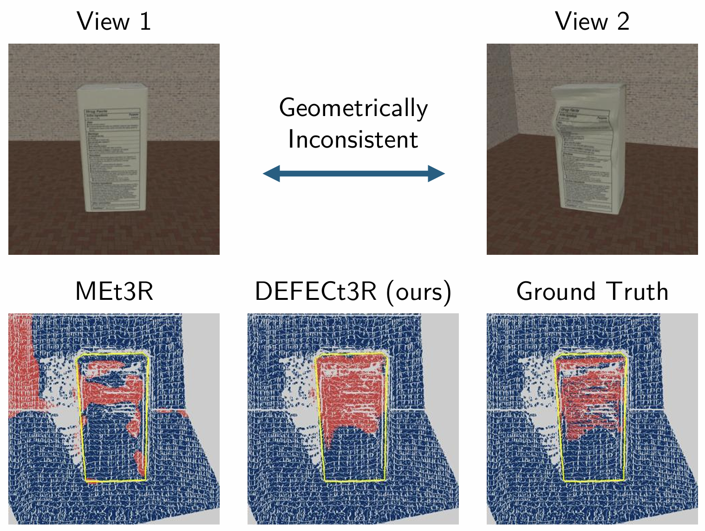
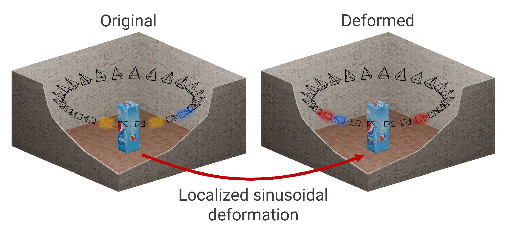
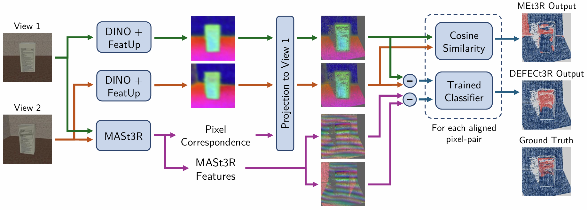

# DeformView & DEFECt3R: Geometric Inconsistency Localization

[![Project page](https://img.shields.io/badge/Project%20page-3F98BD.svg?style=for-the-badge&logo=data:image/svg%2bxml;base64,PHN2ZyB4bWxucz0iaHR0cDovL3d3dy53My5vcmcvMjAwMC9zdmciIHZpZXdCb3g9IjAgMCA1MTIgNTEyIj48cGF0aCBmaWxsPSJ3aGl0ZSIgZD0iTTM1MiAyNTZjMCAyMi4yLTEuMiA0My42LTMuMyA2NEgxNjMuM2MtMi4yLTIwLjQtMy4zLTQxLjgtMy4zLTY0czEuMi00My42IDMuMy02NEgzNDguN2MyLjIgMjAuNCAzLjMgNDEuOCAzLjMgNjR6bTI4LjgtNjRINTAzLjljNS4zIDIwLjUgOC4xIDQxLjkgOC4xIDY0cy0yLjggNDMuNS04LjEgNjRIMzgwLjhjMi4xLTIwLjYgMy4yLTQyIDMuMi02NHMtMS4xLTQzLjQtMy4yLTY0em0xMTIuNi0zMkgzNzYuN2MtMTAtNjMuOS0yOS44LTExNy40LTU1LjMtMTUxLjZjNzguMyAyMC43IDE0MiA3Ny41IDE3MS45IDE1MS42em0tMTQ5LjEgMEgxNjcuN2M2LjEtMzYuNCAxNS41LTY4LjYgMjctOTQuN2MxMC41LTIzLjYgMjIuMi00MC43IDMzLjUtNTEuNUMyMzkuNCAzLjIgMjQ4LjcgMCAyNTYgMHMxNi42IDMuMiAyNy44IDEzLjhjMTEuMyAxMC44IDIzIDI3LjkgMzMuNSA1MS41YzExLjYgMjYgMjAuOSA1OC4yIDI3IDk0Ljd6bS0yMDkgMEgxOC42QzQ4LjYgODUuOSAxMTIuMiAyOS4xIDE5MC42IDguNEMxNjUuMSA0Mi42IDE0NS4zIDk2LjEgMTM1LjMgMTYwek04LjEgMTkySDEzMS4yYy0yLjEgMjAuNi0zLjIgNDItMy4yIDY0czEuMSA0My40IDMuMiA2NEg4LjFDMi44IDI5OS41IDAgMjc4LjEgMCAyNTZzMi44LTQzLjUgOC4xLTY0ek0xOTQuNyA0NDYuNmMtMTEuNi0yNi0yMC45LTU4LjItMjctOTQuNkgzNDQuM2MtNi4xIDM2LjQtMTUuNSA2OC42LTI3IDk0LjZjLTEwLjUgMjMuNi0yMi4yIDQwLjctMzMuNSA1MS41QzI3Mi42IDUwOC44IDI2My4zIDUxMiAyNTYgNTEycy0xNi42LTMuMi0yNy44LTEzLjhjLTExLjMtMTAuOC0yMy0yNy45LTMzLjUtNTEuNXpNMTM1LjMgMzUyYzEwIDYzLjkgMjkuOCAxMTcuNCA1NS4zIDE1MS42QzExMi4yIDQ4Mi45IDQ4LjYgNDI2LjEgMTguNiAzNTJIMTM1LjN6bTM1OC4xIDBjLTMwIDc0LjEtOTMuNiAxMzAuOS0xNzEuOSAxNTEuNmMyNS41LTM0LjIgNDUuMi04Ny43IDU1LjMtMTUxLjZINDkzLjR6Ii8%2BPC9zdmc%2B)](https://xstaelen.github.io/DeformView-DEFECt3R/)
[](https://cloud.ilabt.imec.be/index.php/s/CzaT4EsWnsXQSQP)
[](https://doi.org/10.1145/3840473.3840513)
[](https://arxiv.org/abs/2609.31247)
[![IDLab-MEDIA](https://img.shields.io/badge/IDLab--MEDIA-222222.svg?style=for-the-badge&logo=data:image/svg%2bxml;base64,PHN2ZyB4bWxucz0iaHR0cDovL3d3dy53My5vcmcvMjAwMC9zdmciIHZpZXdCb3g9IjAgMCA2NDAgNTEyIj48cGF0aCBmaWxsPSJ3aGl0ZSIgZD0iTTE0NCAwYTgwIDgwIDAgMSAxIDAgMTYwQTgwIDgwIDAgMSAxIDE0NCAwek01MTIgMGE4MCA4MCAwIDEgMSAwIDE2MEE4MCA4MCAwIDEgMSA1MTIgMHpNMCAyOTguN0MwIDIzOS44IDQ3LjggMTkyIDEwNi43IDE5Mmg0Mi43YzE1LjkgMCAzMSAzLjUgNDQuNiA5LjdjLTEuMyA3LjItMS45IDE0LjctMS45IDIyLjNjMCAzOC4yIDE2LjggNzIuNSA0My4zIDk2Yy0uMiAwLS40IDAtLjcgMEgyMS4zQzkuNiAzMjAgMCAzMTAuNCAwIDI5OC43ek00MDUuMyAzMjBjLS4yIDAtLjQgMC0uNyAwYzI2LjYtMjMuNSA0My4zLTU3LjggNDMuMy05NmMwLTcuNi0uNy0xNS0xLjktMjIuM2MxMy42LTYuMyAyOC43LTkuNyA0NC42LTkuN2g0Mi43QzU5Mi4yIDE5MiA2NDAgMjM5LjggNjQwIDI5OC43YzAgMTEuOC05LjYgMjEuMy0yMS4zIDIxLjNINDA1LjN6TTIyNCAyMjRhOTYgOTYgMCAxIDEgMTkyIDAgOTYgOTYgMCAxIDEgLTE5MiAwek0xMjggNDg1LjNDMTI4IDQxMS43IDE4Ny43IDM1MiAyNjEuMyAzNTJIMzc4LjdDNDUyLjMgMzUyIDUxMiA0MTEuNyA1MTIgNDg1LjNjMCAxNC43LTExLjkgMjYuNy0yNi43IDI2LjdIMTU0LjdjLTE0LjcgMC0yNi43LTExLjktMjYuNy0yNi43eiIvPjwvc3ZnPg==)](https://media.idlab.ugent.be/)

> **TL;DR:** Two views of a scene can each look real, yet contradict each other geometrically. We release **DeformView**, a wide-baseline multi-view dataset with pixel-level labels of such **geometric inconsistencies**, and propose **DEFECt3R**, a lightweight classifier that localizes them. Existing consistency metrics transfer poorly to this forensic task; DEFECt3R localizes inconsistencies better and drastically reduces false positives. 

Official repository of the paper **"Geometric Inconsistency Localization in Multi-View Image Sets"** (Xander Staelens, Albéric Loos, Bert Ramlot, Hannes Mareen, Peter Lambert, Glenn Van Wallendael — IDLab, Ghent University – imec).

<p align="center">
  <br/>
  <sub>Two views of the same object that look plausible on their own, but are geometrically inconsistent with each other. MEt3R's response map vs. the inconsistency map predicted by DEFECt3R and the ground truth.</sub>
</p>

## Overview

Novel view synthesis models can generate realistic **new views** of a scene, but these views are **not always geometrically consistent** with one another. Multi-view (MV) consistency is therefore a promising signal for multimedia forensics, yet existing consistency-scoring methods were designed to *evaluate* generative models: they produce a global score, or need many highly-overlapping views.

This repository contains:

- **DeformView**: a wide-baseline MV dataset with **pixel-level annotations** of geometric inconsistencies. 1029 objects from Google Scanned Objects are rendered from 24 viewpoints, both original and with a localized 3D mesh deformation. Pairs are up to 120° apart and come in three types:
  - *original–deformed* (inconsistent),
  - *original–original* (easy negatives),
  - *deformed–deformed* (hard negatives: unusual geometry, but consistent across views).
- **DEFECt3R**: a lightweight (~63k parameters) per-pixel classifier for geometric inconsistency localization. It builds on the MEt3R pipeline: DINO features upsampled with FeatUp, aligned across views with MASt3R correspondences. Instead of turning feature dissimilarity directly into a score, DEFECt3R learns from the aligned DINO (and MASt3R) feature differences whether a pixel is truly inconsistent.
- **Evaluation code** for the pixel- and pair-level benchmarks of the paper, for DEFECt3R and the baselines **MEt3R** and **TSED**.


## Repository structure

```
DEFECt3R/           # The DEFECt3R model
  defect3r.py       #   DEFECt3R: combines everything below with the trained classifier
  aligned_features.py  # shared pipeline (DINO + FeatUp → correspondences → per-pixel feature differences)
  dino.py, featup.py   # DINO ViT-S/16 features, FeatUp upsampling
  mast3r.py            # MASt3R correspondences (+ 24-d MASt3R descriptors)
  gt_correspondence.py # correspondences from GT camera poses + depth maps (DeformView only)
  classifier.py        # the per-pixel MLPs
  weights/             # trained classifiers (one per variant, see below)
  third_party/mast3r   # MASt3R (git submodule)
MEt3R/              # MEt3R baseline (cosine distance of the aligned DINO features)
TSED/               # TSED baseline (SIFT matches + symmetric epipolar distance)
DeformView/         # Dataset loading, camera poses and the train/val/test pair lists
  splits/           #   pair lists (MASt3R correspondences, TSED)
  split_GT/         #   pair lists (GT correspondences)
evaluation/         # Pixel- and pair-level evaluation scripts
create_env.sh       # Conda environment setup script
```

## Setup

```bash
git clone --recursive https://github.com/IDLabMedia/DeformView-DEFECt3R.git
cd DeformView-DEFECt3R
bash create_env.sh
conda activate ./env/DEFECt3R
```

If you cloned without `--recursive`, fetch MASt3R with `git submodule update --init --recursive`.

This creates a local conda environment (`env/DEFECt3R`) with PyTorch 2.5.1 (CUDA 12.1), and compiles PyTorch3D and FeatUp. The DINO/FeatUp weights (`torch.hub`) and the MASt3R weights (Hugging Face) are downloaded automatically on first use. The DEFECt3R classifiers are included in `DEFECt3R/weights/`.

## Proposed dataset: DeformView

<p align="center">
  
</p>

DeformView contains 1029 objects from Google Scanned Objects, each rendered from 24 viewpoints both as the original mesh and with a localized 3D deformation, with pixel-level ground-truth masks. Pairs are up to 120° apart and come in three types: original–deformed (positive, blue), original–original (negative, yellow) and deformed–deformed (hard negative, red).

<!-- TODO: link -->
DeformView can be [downloaded here](https://cloud.ilabt.imec.be/index.php/s/CzaT4EsWnsXQSQP). The renders are split into one archive per split (`train`, `val`, `test`); `train` is split into 4 GB parts. To reproduce the paper's test results, only `test` is needed. Unpack the archives into the same folder (requires `zstd`) and pass that folder to the evaluation scripts with `--data_root`:

```bash
sha256sum -c --ignore-missing SHA256SUMS                           # optional: verify the downloads
tar -I zstd -xf DeformView_renders_test.tar.zst
tar -I zstd -xf DeformView_renders_val.tar.zst
cat DeformView_renders_train.tar.zst.part* | tar -I zstd -xf -     # train: join the parts
```

Single files can also be downloaded from the command line:

```bash
URL=https://cloud.ilabt.imec.be/index.php/s/CzaT4EsWnsXQSQP/download
for f in SHA256SUMS DeformView_renders_test.tar.zst; do curl -fL -o "$f" "$URL?path=/&files=$f"; done
```

Expected layout:

```
<data_root>/DeformView_renders/<object>/
  camera_params.npz            # camera ring (shared by the original and deformed renders)
  original/
    {angle}.png                # render of the original mesh
    {angle}_fg.png             # foreground (object) mask
    {angle}_depth.npy          # depth map (only for GT correspondences)
  deformed/
    {angle}.png                # render of the deformed mesh
    {angle}_mask.png           # deformation mask (ground truth)
    {angle}_depth.npy          # depth map (only for GT correspondences)
```

The pair lists in `DeformView/splits/` and `DeformView/split_GT/` are the exact train/val/test pairs used in the paper. The split is object-based (75/15/10%), so no object appears in more than one split. The GT-correspondence runs use a slightly smaller pair list (`split_GT/`) from which pairs with too little overlap were removed.

## Proposed model: DEFECt3R

<p align="center">
  <br/>
</p>

DEFECt3R takes two images and returns a pixel-level inconsistency heatmap in the frame of view 1. Pose estimation and feature extraction happen inside the model. Three trained variants are available:

| `features` | `correspondence` | Weights |
|---|---|---|
| `dino+mast3r` | `mast3r` | `dino_mast3r__mast3r.pt` |
| `dino` | `mast3r` | `dino__mast3r.pt` |
| `dino` | `gt` (DeformView only) | `dino__gt.pt` |

```python
from DEFECt3R import DEFECt3R, load_image

model = DEFECt3R(features="dino+mast3r", correspondence="mast3r").cuda()
img1 = load_image("view1.png").cuda()   # (3, 512, 512) in [-1, 1]
img2 = load_image("view2.png").cuda()

out = model(img1, img2)
out["heatmap"]      # (512, 512) inconsistency probability, NaN outside the overlap of both views
out["prediction"]   # (512, 512) heatmap > validation-selected threshold
```

With `correspondence="gt"`, also pass `depth1`, `depth2`, `pose1` and `pose2` (see `DeformView/dataset.py` for loading them). `MEt3R(correspondence=...)` has the same interface and returns its cosine-distance map. `TSED(correspondence=...)` takes two image paths and returns a single pair-level score.

## Paper Evaluation

Run from within `evaluation/`:

```bash
python eval_pixel_level.py --model [model] --features [features] --corr [correspondence] --data_root [DeformView folder]
python eval_pair_level.py  --model [model] --features [features] --corr [correspondence] --agg [aggregation] --data_root [DeformView folder]
```

Options:
- `--model`: `DEFECt3R`, `MEt3R`, or `TSED` (pair-level only)
- `--features`: `dino` or `dino+mast3r` (DEFECt3R with MASt3R correspondences only)
- `--corr`: `mast3r` (estimated) or `gt` (ground-truth poses and depth)
- `--agg`: pair-level aggregation of the heatmap, `p99` and/or `mean` (default: `p99`)
- `--split`: `train`, `val`, or `test` (default: `test`); `--pairs` uses a custom pair file instead
- `--threshold`: override the decision threshold (by default the validation-selected thresholds of the paper are used)
- `--device`: e.g. `cuda` or `cpu`

Examples:
```bash
python eval_pixel_level.py --model DEFECt3R --features dino+mast3r --corr mast3r --data_root ../DeformView
python eval_pair_level.py  --model MEt3R --corr gt --agg p99 mean --data_root ../DeformView
python eval_pair_level.py  --model TSED --corr mast3r --data_root ../DeformView
```

Every model × features × correspondence × split combination is computed only once. Per-pair results are cached in `evaluation/results/`, so pixel- and pair-level evaluation share the same model outputs, and interrupted runs resume where they stopped. Metrics are written to `pixel_metrics.csv` / `pair_metrics.csv` in the run folder.

_Note:_ Results may differ slightly from those reported in the paper due to differences in software versions, hardware, and numerical nondeterminism.

## Citation

If you use this work, please cite:

```bibtex
@inproceedings{Staelens_2026_DFF_ACMMM,
    author    = {Staelens, Xander and Loos, Alb{\'e}ric and Ramlot, Bert and Mareen, Hannes and Lambert, Peter and Van Wallendael, Glenn},
    title     = {Geometric Inconsistency Localization in Multi-View Image Sets},
    year      = {2026},
    isbn      = {9798400729270},
    publisher = {Association for Computing Machinery},
    address   = {New York, NY, USA},
    url       = {https://doi.org/10.1145/3840473.3840513},
    doi       = {10.1145/3840473.3840513},
    booktitle = {Proceedings of the 2nd Deepfake Forensics Workshop: Detection, Attribution, Recognition, and Adversarial Challenges in the Era of AI-Generated Media (DFF '26 @ ACMMM 2026)},
    pages     = {68--75},
    numpages  = {8},
    location  = {Rio de Janeiro, Brazil},
    series    = {DFF '26}
}
```

## Acknowledgments

This work was funded in part by IDLab (Ghent University – imec), by Flanders Innovation & Entrepreneurship (VLAIO), by Research Foundation – Flanders (FWO) (1SA9O26N & G0A2523N), and by the European Union.

DeformView is built on [Google Scanned Objects](https://research.google/blog/scanned-objects-by-google-research-a-dataset-of-3d-scanned-common-household-items/). DEFECt3R builds on [MEt3R](https://geometric-rl.mpi-inf.mpg.de/met3r/), [MASt3R](https://github.com/naver/mast3r), [DINO](https://github.com/facebookresearch/dino) and [FeatUp](https://mhamilton.net/featup); the TSED baseline follows Yu et al., "Long-Term Photometric Consistent Novel View Synthesis with Diffusion Models" (ICCV 2023). Please refer to their respective licenses for terms of use of the underlying models and code (MASt3R is licensed under CC BY-NC-SA 4.0).
